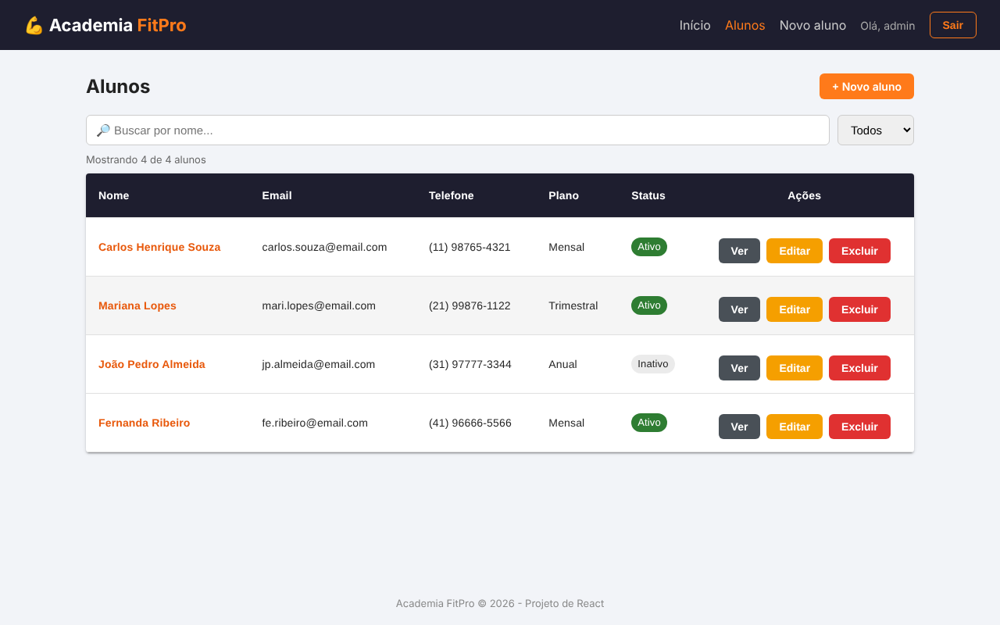
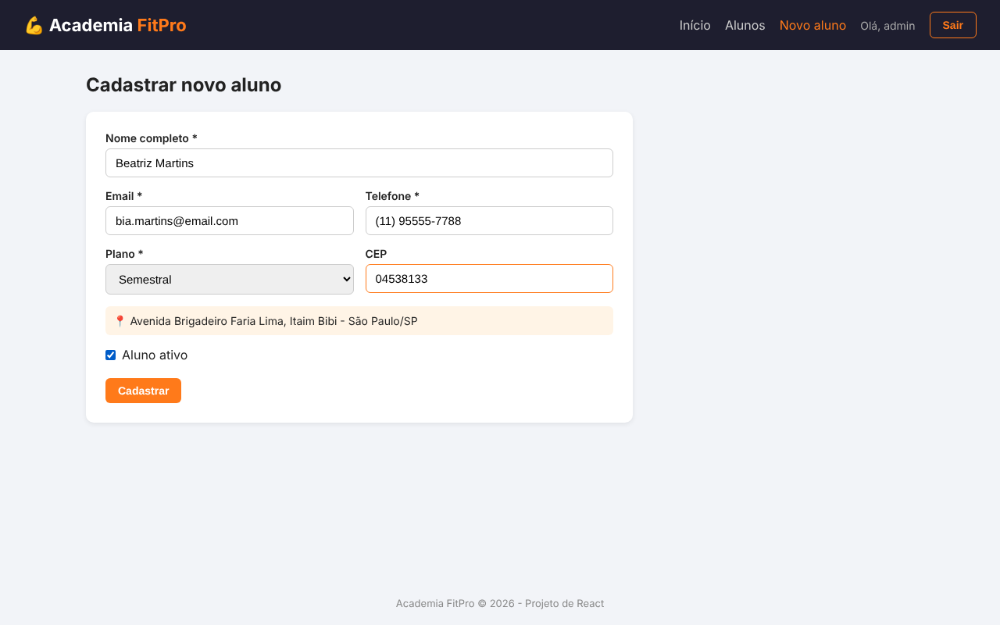
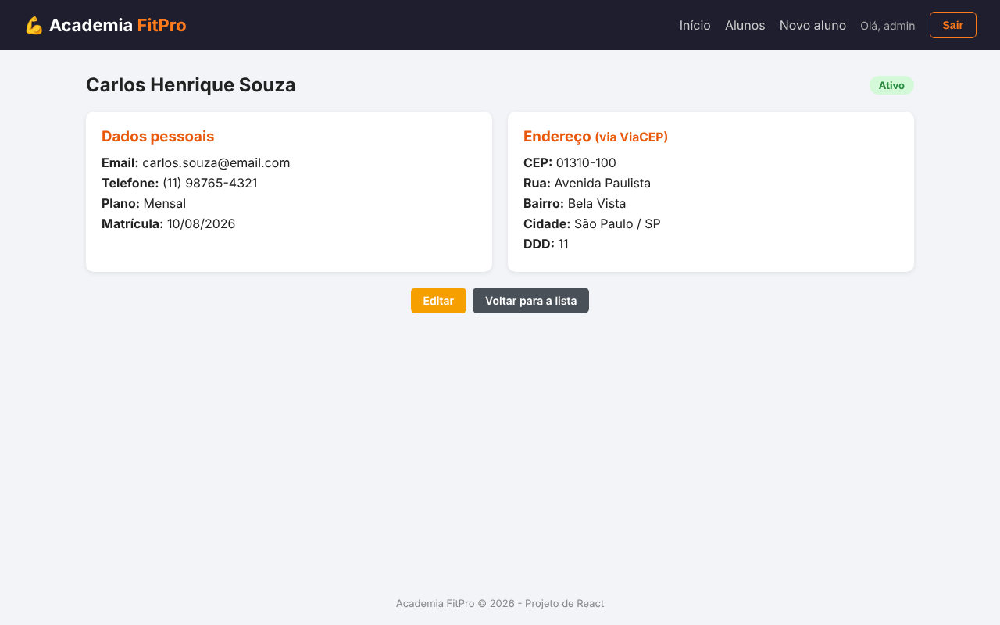

# Academia FitPro

Aplicação web desenvolvida em React para gerenciamento de alunos de uma academia.

O projeto foi desenvolvido em três features durante a disciplina, começando pela interface e pelo CRUD básico, passando pelo gerenciamento de estado e terminando com integração com API externa e navegação entre páginas.

## Repositório

GitHub:

https://github.com/Leochacarolli/academia-fit

---

# Visão geral

O sistema permite cadastrar, consultar, atualizar e remover alunos da academia.

Funcionalidades:

- cadastro de alunos com validação dos campos;
- listagem com busca por nome e filtro por status;
- página de detalhes do aluno;
- edição e exclusão com confirmação;
- busca do endereço pelo CEP usando a API do ViaCEP;
- área administrativa protegida por login.

---

# Tecnologias utilizadas

- React 19
- Vite
- React Router DOM
- Axios
- Fetch API
- TanStack React Query
- Material UI
- json-server
- ViaCEP
- CSS
- Git / GitHub

---

# Estrutura do projeto

```text
src
├── components
│   ├── AlunoForm.jsx
│   ├── Botao.jsx
│   ├── Mensagem.jsx
│   ├── Navbar.jsx
│   ├── RotaPrivada.jsx
│   └── TabelaAlunos.jsx
├── context
│   ├── AlunosContext.jsx
│   └── AuthContext.jsx
├── hooks
│   └── useForm.js
├── pages
│   ├── DetalhesAluno.jsx
│   ├── EditarAluno.jsx
│   ├── Home.jsx
│   ├── ListaAlunos.jsx
│   ├── Login.jsx
│   ├── NaoEncontrada.jsx
│   └── NovoAluno.jsx
├── services
│   ├── api.js
│   └── cepService.js
├── utils
│   └── validacao.js
├── App.jsx
├── index.css
└── main.jsx
```

O arquivo `db.json` na raiz é usado pelo json-server como banco de dados.

---

# Execução

## Pré-requisitos

- Node.js 18 ou superior
- npm

## 1. Instalar as dependências

```bash
npm install
```

## 2. Iniciar a aplicação

```bash
npm start
```

Esse comando sobe o json-server na porta 3001 e o React na porta 5173.

Também é possível rodar separado:

```bash
npm run server
```

```bash
npm run dev
```

## 3. Acessar

```text
http://localhost:5173
```

Usuário de teste:

```text
usuário: admin
senha: 1234
```

---

# Rotas

| Rota | Página | Privada |
|------|--------|---------|
| `/` | Início | Não |
| `/login` | Login | Não |
| `/alunos` | Lista de alunos | Sim |
| `/alunos/novo` | Cadastro | Sim |
| `/alunos/:id` | Detalhes | Sim |
| `/alunos/:id/editar` | Edição | Sim |

---

# Endpoints da API (json-server)

```text
GET    http://localhost:3001/alunos
GET    http://localhost:3001/alunos/:id
POST   http://localhost:3001/alunos
PUT    http://localhost:3001/alunos/:id
DELETE http://localhost:3001/alunos/:id
```

API externa:

```text
GET https://viacep.com.br/ws/{cep}/json/
```

---

# Evolução do projeto

## Feature 1 — JavaScript moderno e interface com React

CRUD em uma única tela, consumindo o json-server com Axios.

Conceitos utilizados:

- arrow functions;
- destructuring;
- spread / rest;
- módulos e imports;
- template literals;
- componentes reutilizáveis;
- JSX;
- CSS e Material UI.

Tag:

```text
feature-1
```

---

## Feature 2 — Gerenciamento de dados e reatividade

O estado dos alunos foi movido para um contexto e o formulário passou a usar um hook personalizado.

Foram introduzidos:

- useState e useEffect;
- hook personalizado `useForm`;
- Context API;
- renderização condicional;
- mensagens de sucesso e erro;
- busca e filtro na lista;
- Promises e tratamento de erros.

Tag:

```text
feature-2
```

---

## Feature 3 — APIs externas e navegação

A aplicação foi dividida em páginas e integrada com a API do ViaCEP.

Foram introduzidos:

- React Router;
- rota privada com login;
- formulário não controlado (login com useRef);
- Fetch API para o ViaCEP;
- React Query com cache;
- Promise.race para timeout das requisições;
- AbortController para cancelar requisições.

Tag:

```text
feature-3
```

---

# Screenshots

## Lista de alunos



## Cadastro com busca de CEP



## Detalhes do aluno


